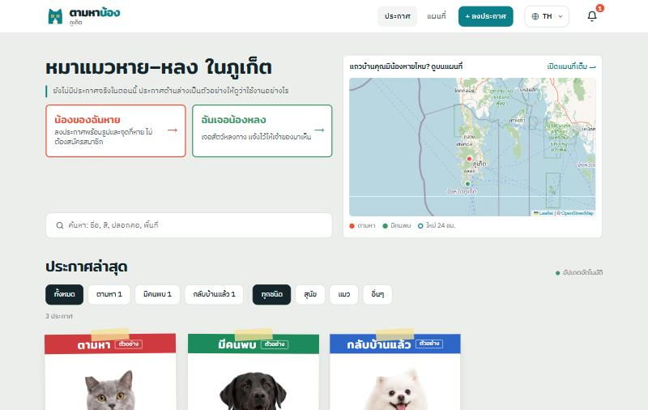
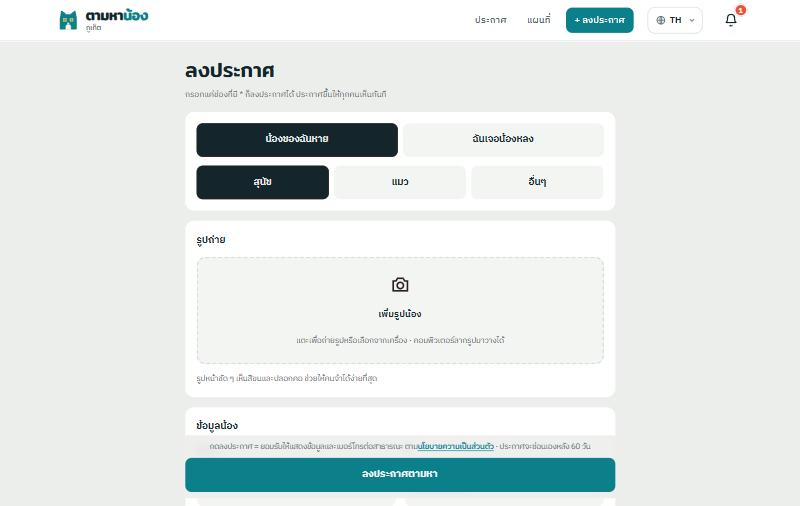
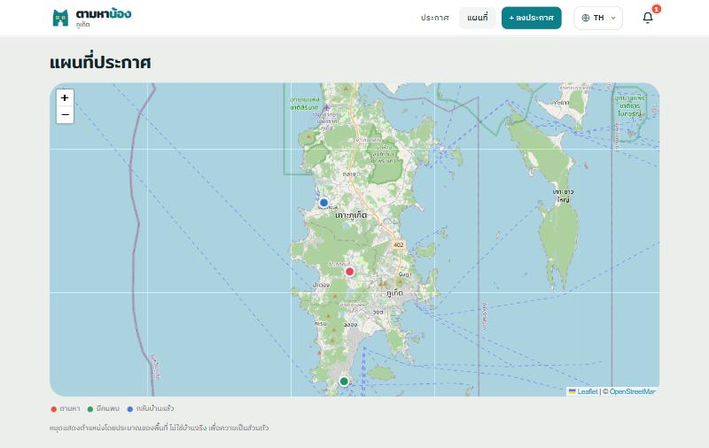
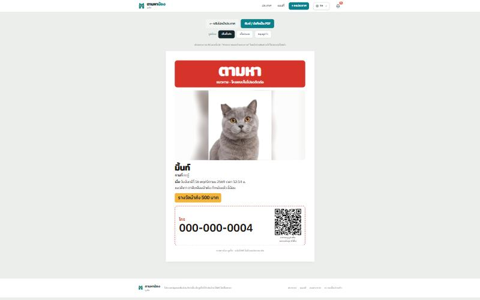

# ตามหาน้อง ภูเก็ต (Tamha Nong Phuket)

**English** · [ไทย](README.th.md)

**Live site: [tamha-nong.vercel.app](https://tamha-nong.vercel.app)**

A lost-and-found pet board for Phuket. Post once, instead of copy-pasting into every Facebook group. The site opens in Thai and can be switched to English, Chinese or Russian for tourists and expats.



| Post a report | Map | QR poster |
|---|---|---|
|  |  |  |

## Features

- Report a lost or found pet with a photo of the animal and of the place (HEIC photos from iPhone are supported)
- Pin the location on a map: use your current position or paste a Google Maps link
- "I saw this one" button, so people can report where and when they spotted the pet
- Phone alerts (Web Push) for the person who posted: when someone taps "I saw this one", their phone gets a notification even if the site is closed. Encryption (RFC 8291) and VAPID signing (RFC 8292) are written with `node:crypto`, with no extra library. On iPhone the site must be added to the Home Screen first (iOS 16.4+)
- Directions to the pin through Google Maps
- Printable A4 poster with a QR code
- Owners can close or delete their own post without creating an account
- New posts appear on every device instantly; posts older than 60 days are hidden automatically
- Admin page: edit, hide, delete, review reports, export CSV
- Installable on phones as a PWA
- 4 languages: Thai, English, 中文, Русский. Text people type in their posts (pet name, description, reward) is machine-translated with the free MyMemory API and cached in the browser
- Home page designed as a community notice board: posts look like paper flyers with tape and tear-off phone tabs; the counters only count real posts, not samples

**Tech stack:** Next.js 15 · React 19 · Supabase (PostgreSQL, Storage, Realtime, Auth) · Leaflet + OpenStreetMap · Vercel

## Run locally

Requires Node.js 20 or newer.

1. Create a project at [supabase.com](https://supabase.com) (region: Singapore).
2. In the SQL Editor, run `supabase/schema.sql`, then `supabase/UPDATE_ALL.sql`.
3. Copy `.env.example` to `.env.local` and fill in your Project URL and anon key.
4. Start the dev server:

```bash
npm install
npm run dev
```

Open http://localhost:3000. To try it on a phone on the same Wi-Fi, use `http://<your computer's IP>:3000`.

### Set up an admin

In Supabase, go to Authentication → Users → Add user (tick Auto Confirm), then run this in the SQL Editor:

```sql
insert into public.admins (user_id)
select id from auth.users where email = 'your-email@example.com'
on conflict do nothing;
```

Then turn off "Allow new users to sign up" in the Authentication settings.

The admin page is at `/admin`. It is not linked from the public pages.

## Deploy

Import this repo into Vercel, add `NEXT_PUBLIC_SUPABASE_URL` and `NEXT_PUBLIC_SUPABASE_ANON_KEY`, and deploy.

For phone alerts, also add `VAPID_PUBLIC_KEY`, `VAPID_PRIVATE_KEY` (a P-256 key pair; the public key must match `lib/push-client.js`) and `PUSH_SECRET` (any long random string), then run `supabase/010_push.sql` with the same `PUSH_SECRET`. A daily Vercel cron calls `/api/keepalive` so the free Supabase project is not paused.
Then set your site URL in Supabase → Authentication → URL Configuration → Site URL (only needed for password-reset emails).

## Project structure

```
app/            pages (home, map, new post, post detail, poster, admin)
components/     UI components
lib/            area data and database helpers
supabase/       SQL for tables, permissions and upgrades
public/         icons and sample images
```

## Security

- Row Level Security on every table. The browser can read, but cannot write directly; all writes go through database functions.
- Edit tokens are random 128-bit values, stored as bcrypt hashes. The real token lives only in the owner's browser.
- Rate limits per IP on posting, sightings, uploads and token guessing.
- Only image URLs from the site's own storage are accepted, and only JPG/PNG/WebP up to 5 MB.
- Security headers (CSP, X-Frame-Options, nosniff, HSTS) and CSV-injection protection in exports.
- Never put the `service_role` key in the code or in `.env.local`.

## Roadmap

- Alerts when a pet goes missing near you
- CAPTCHA (Cloudflare Turnstile)

