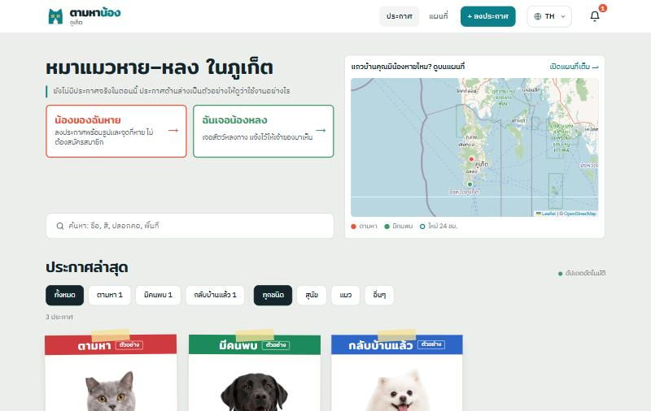
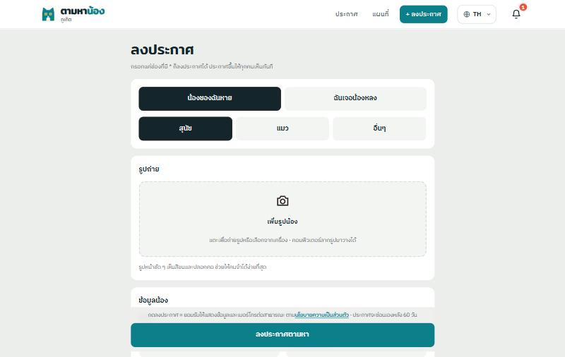
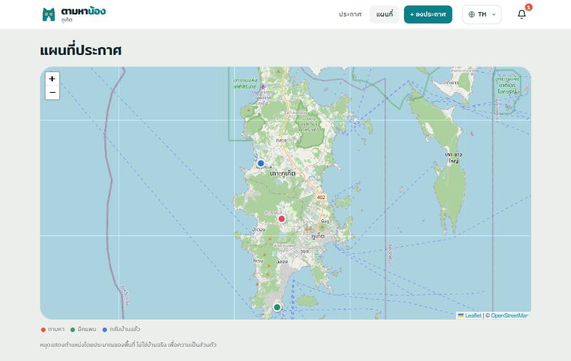
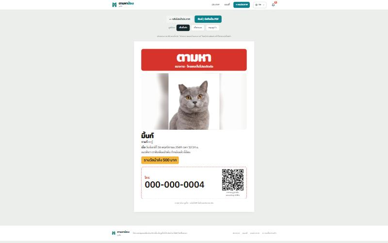

**[English](README.md)** · ไทย

# ตามหาน้อง ภูเก็ต

**เว็บจริง: [tamha-nong.vercel.app](https://tamha-nong.vercel.app)**

เว็บรวมประกาศหมาแมวหายและที่มีคนพบในภูเก็ต ลงครั้งเดียว ไม่ต้องไล่โพสต์ทีละกลุ่มเฟซบุ๊ก เปิดมาเป็นภาษาไทย และเปลี่ยนเป็นอังกฤษ จีน หรือรัสเซียได้ สำหรับนักท่องเที่ยวและชาวต่างชาติ



| ลงประกาศ | แผนที่ | โปสเตอร์ QR |
|---|---|---|
|  |  |  |

## ทำไมถึงทำเว็บนี้

เวลาสัตว์เลี้ยงหายในภูเก็ต ประกาศมักถูกโพสต์ในกลุ่มเฟซบุ๊กไม่กี่กลุ่ม แล้วจมหายภายในไม่กี่ชั่วโมง ไม่มีหมุดบนแผนที่ คนที่เห็นก็บอกไม่ได้ว่าเห็นตรงไหนเมื่อไหร่ และเจ้าของต้องคัดลอกข้อความไปวางทุกกลุ่ม

ผมอยากได้ที่เดียวที่แก้ทั้งสามเรื่อง คือปักหมุดบนแผนที่ ปุ่ม "ฉันเห็นตัวนี้" แตะเดียว และโปสเตอร์พิมพ์ได้พร้อม QR Code ส่วนที่ตัดสินใจไว้และอธิบายได้

- **ไม่ต้องสมัครสมาชิก** ตอนกำลังร้อนใจ การลงประกาศควรใช้เวลาไม่ถึงนาที ประกาศแต่ละอันได้รหัสแก้ไขแบบสุ่มที่อยู่ในเบราว์เซอร์ของเจ้าของ ฐานข้อมูลเก็บเฉพาะค่าแฮช
- **หน้าเว็บเขียนตารางตรง ๆ ไม่ได้** Row Level Security กันไว้ ทุกการเขียนต้องผ่านฟังก์ชันในฐานข้อมูลที่จำกัดจำนวนครั้ง
- **แจ้งเตือนเข้ามือถือโดยไม่ใช้ไลบรารี** การเข้ารหัส Web Push (RFC 8291) และการเซ็น VAPID (RFC 8292) เขียนด้วย `node:crypto` และตรวจกับตัวอย่างทดสอบในมาตรฐานแล้ว

## ทำอะไรได้

- ลงประกาศหายหรือพบ พร้อมรูปน้องและรูปสถานที่ (รองรับไฟล์ HEIC จาก iPhone)
- ปักหมุดบนแผนที่ ใช้ตำแหน่งปัจจุบัน หรือวางลิงก์ Google Maps
- ปุ่ม "ฉันเห็นตัวนี้" ให้คนแจ้งจุดและเวลาที่เห็น
- แจ้งเตือนเข้ามือถือ (Web Push) ให้คนลงประกาศ เมื่อมีคนกด "ฉันเห็นตัวนี้" มือถือจะเด้งเตือนแม้ปิดเว็บอยู่ เข้ารหัส (RFC 8291) และเซ็น VAPID (RFC 8292) ด้วย `node:crypto` ไม่ใช้ไลบรารีเพิ่ม บน iPhone ต้องเพิ่มเว็บไปยังหน้าจอโฮมก่อน (iOS 16.4 ขึ้นไป)
- นำทางไปที่หมุดด้วย Google Maps
- พิมพ์โปสเตอร์ A4 พร้อม QR Code
- เจ้าของปิดหรือลบประกาศเองได้โดยไม่ต้องสมัครสมาชิก
- ประกาศใหม่ขึ้นทุกเครื่องทันที ประกาศเกิน 60 วันซ่อนอัตโนมัติ
- หน้าผู้ดูแล: แก้ ซ่อน ลบ ดูรายงาน ส่งออก CSV
- ติดตั้งเป็นแอปบนมือถือได้ (PWA)
- 4 ภาษา: ไทย, English, 中文, Русский ข้อความที่คนพิมพ์ลงประกาศ (ชื่อ คำอธิบาย ค่าตอบแทน) แปลอัตโนมัติด้วย MyMemory API (ฟรี) และจำผลแปลไว้ในเบราว์เซอร์
- หน้าแรกแบบบอร์ดประกาศชุมชน การ์ดเหมือนใบประกาศติดเสาไฟ มีเทปกาวและรอยปรุเบอร์โทร ตัวเลขสถิตินับเฉพาะประกาศจริง ไม่นับประกาศตัวอย่าง

**เทคโนโลยี:** Next.js 15 · React 19 · Supabase (PostgreSQL, Storage, Realtime, Auth) · Leaflet + OpenStreetMap · Vercel

## รันบนเครื่อง

ต้องมี Node.js 20 ขึ้นไป

1. สร้างโปรเจกต์ที่ [supabase.com](https://supabase.com) (Region: Singapore)
2. SQL Editor → รัน `supabase/schema.sql` แล้วตามด้วย `supabase/UPDATE_ALL.sql`
3. คัดลอก `.env.example` เป็น `.env.local` ใส่ Project URL และ anon key
4. รัน

```bash
npm install
npm run dev
```

เปิด http://localhost:3000 บนมือถือในวง Wi-Fi เดียวกันใช้ `http://<IP ของคอม>:3000`

### ตั้งผู้ดูแล

Supabase → Authentication → Users → Add user (ติ๊ก Auto Confirm) แล้วรันใน SQL Editor:

```sql
insert into public.admins (user_id)
select id from auth.users where email = 'อีเมลของคุณ'
on conflict do nothing;
```

จากนั้นปิด "Allow new users to sign up" ในหน้า Authentication

## ขึ้นเว็บจริง

Import repo นี้ใน Vercel ใส่ `NEXT_PUBLIC_SUPABASE_URL` และ `NEXT_PUBLIC_SUPABASE_ANON_KEY` แล้ว Deploy

ถ้าจะใช้แจ้งเตือนเข้ามือถือ ใส่เพิ่ม `VAPID_PUBLIC_KEY`, `VAPID_PRIVATE_KEY` (กุญแจคู่ P-256 กุญแจสาธารณะต้องตรงกับใน `lib/push-client.js`) และ `PUSH_SECRET` (ข้อความสุ่มยาว ๆ) แล้วรัน `supabase/010_push.sql` โดยใส่ `PUSH_SECRET` ตัวเดียวกัน มี Vercel cron เรียก `/api/keepalive` วันละครั้ง กันโปรเจกต์ Supabase ฟรีถูกพัก
จากนั้นใส่ลิงก์เว็บใน Supabase → Authentication → URL Configuration → Site URL

## โครงสร้าง

```
app/            หน้าเว็บ (หน้าแรก, แผนที่, ลงประกาศ, ประกาศ, โปสเตอร์, ผู้ดูแล)
components/     ส่วนประกอบหน้าเว็บ
lib/            ข้อมูลพื้นที่ และฟังก์ชันคุยกับฐานข้อมูล
supabase/       ไฟล์ SQL สร้างตาราง สิทธิ์ และอัปเกรด
public/         ไอคอนและรูปตัวอย่าง
```

## ความปลอดภัย

- Row Level Security ทุกตาราง หน้าเว็บอ่านได้ แต่เขียนตรงไม่ได้ ต้องผ่านฟังก์ชันในฐานข้อมูล
- รหัสแก้ไขประกาศสุ่ม 128 บิต เก็บแบบ bcrypt ตัวจริงอยู่แค่ในเบราว์เซอร์ของเจ้าของ
- จำกัดจำนวนการโพสต์ แจ้งเห็น อัปโหลด และเดารหัส ต่อ IP
- รับลิงก์รูปจากที่เก็บรูปของเว็บเท่านั้น และรับเฉพาะ JPG/PNG/WebP ไม่เกิน 5 MB
- Security headers (CSP, X-Frame-Options, nosniff, HSTS) และกัน CSV injection ในไฟล์ส่งออก
- ห้ามใส่ `service_role` key ในโค้ดหรือ `.env.local`

## ที่จะทำต่อ

- แจ้งเตือนเมื่อมีน้องหายใกล้บ้าน
- CAPTCHA (Cloudflare Turnstile)
